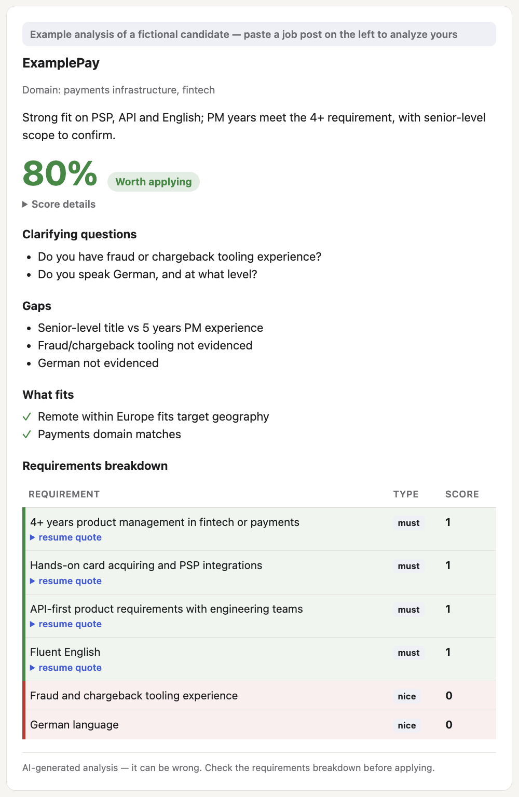

# Vacancy Decoder

**Paste a job post — get a company brief, your resume match and what is missing. In 30 seconds.**

A pet project built with Claude Code to learn how to ship an LLM product end to end: brief → prompt → structured output → evals → guardrails → deploy.

- **Live demo:** [vacancy-decoder.vercel.app](https://vacancy-decoder.vercel.app/) (password-protected — ask me for access; inside, **Try a sample** runs a live analysis of a fictional candidate)
- **Product brief:** [BRIEF.md](BRIEF.md) · **How decisions were made:** [DECISIONS.md](DECISIONS.md) · **Eval set:** [GOLDEN_SET.md](GOLDEN_SET.md)

<p align="center"></p>

## What it does

| Feature | Details |
|---|---|
| **Match score** | Must 60% / nice-to-have 20% / function + domain 20%. Open hard gates cap the score at 40% (two or more → 25%) |
| **Verdict** | Worth applying (≥ 70) · Think it over (40–69) · Skip (< 40 or a hard gate) |
| **Requirements breakdown** | Every requirement scored 1 / 0.5 / 0 with a verbatim resume quote as evidence |
| **Gaps & what fits** | Missing skills, location conflicts, red flags stated in the post |
| **Clarifying questions** | Answer inline → saved as "resume additions" → the score is recalculated |
| **Changes** | Compare two runs of the same job post: score delta, changed requirements, new answers |
| **Insights** | On demand: the common pattern behind today's low scores + one recommendation |

## Key product decisions

1. **The LLM labels, the code scores.** The model extracts requirements and labels each one; the percentage, caps and verdict are computed by deterministic code ([lib/scoring.js](lib/scoring.js)). Same labels → same score.
2. **Rules the model kept breaking moved into code** ([lib/guards.js](lib/guards.js)):
   - years of experience are computed from resume dates, not by the model (it miscounted "Jan 2021 – Dec 2025" as 2 to 5 years);
   - working conditions (time zone, relocation) are never requirements;
   - a location conflict counts only with a verbatim quote from the job post;
   - one bullet = one requirement (split bullets are merged back);
   - "what fits" items and preference questions are filtered out of gaps and questions.
3. **Evidence or no credit.** No verbatim quote → score 0 + a clarifying question.
4. **Effort `medium` over `low`.** Low was cheaper and faster but swung up to 15 points between runs on borderline requirements; medium keeps the spread ≤ 3 points at ~2.5× the cost (~$0.003 per analysis).

## Evals

A golden set of 5 real job posts, each scored **by hand** with the brief's formula, then compared to the app (3 runs each):

| Test | Target | Result (effort medium) |
|---|---|---|
| a. Accuracy | within ±10 points of the hand score | **5 / 5** (max diff 7) |
| b. Stability | spread ≤ 10 points across 3 runs | **5 / 5** (max spread 3) |
| c. Language | answer in the job post's language | EN / RU ✅ |
| Hard gates | capped at 40% / 25% | ✅ |

Lesson learned: the first AI-drafted reference had errors (missing cap, wrong formula, soft skills counted) — the reference itself has to be human-verified. 24 unit tests cover the formula and the guards (`npm run test:scoring`, no API calls).

## Privacy & security

- The profile, resume and history live **only in the user's browser** (localStorage); the server stores nothing and logs only token counts and cost.
- The API key exists only in server-side functions; a shared password is checked server-side with a timing-safe comparison.
- Model output is rendered as text only (no `innerHTML`); the prompt treats the job post and resume as data, not instructions.
- Only `public/` is served; strict security headers (CSP, no framing); a $10/month spend limit caps the worst case.

## Architecture

```
public/index.html            browser: UI, profile and today's history in localStorage
   │  POST + password header
   ▼
api/analyze · daily · auth   Vercel serverless functions (hold the API key)
   ├─ lib/claude.js          Claude API: claude-haiku-5-5, effort medium, JSON schema output, retry on max_tokens
   ├─ lib/guards.js          deterministic checks on top of the model output
   └─ lib/scoring.js         match formula and hard-gate caps
```

Stack: vanilla HTML/JS (no framework, ~12 KB gzipped), Node.js serverless functions, Anthropic SDK, Vercel.

## Known limitations

- Daily limits (50 analyses, 3 insights) are counted in the browser; the real budget guard is the API spend limit.
- Resume upload accepts text / .txt / .md (no PDF yet).
- The model's wording in "Gaps" can occasionally disagree with the code-computed numbers.

## Run locally

1. `cp .env.example .env` and fill in `ANTHROPIC_API_KEY` and `APP_PASSWORD`.
2. `npm install`
3. `npm run dev` → http://localhost:3000
4. `npm run test:scoring` — unit tests, free (no model calls).
